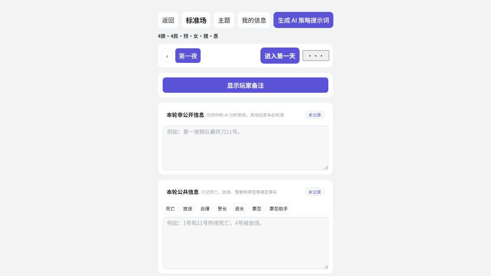

# Wolf-Notes

A local-first notebook for Werewolf and Who Is the Undercover. Record what players said, separate public events from private knowledge, and revisit the evidence as the game unfolds. The interface is primarily in Chinese.

[Open Wolf-Notes](https://seiya058904.github.io/Wolf-Notes/) · [Run locally](#run-locally) · [Upstream and license](#upstream-and-license)

*Original deduction illustration, not an application screenshot.*

## Features

- **Follow the rounds:** keep night and day events in order and return to earlier records.
- **Record the table:** capture speeches, votes, eliminations, claims, and your own deductions by player and round.
- **Separate information:** keep public events apart from role-specific knowledge and private notes; retained notes can be flagged for review after a role change.
- **Use two workspaces:** Werewolf has a round-based record and setup flow; Who Is the Undercover has a separate notes view.
- **Prepare a strategy prompt:** assemble a copyable Werewolf prompt from the record without calling an AI service from the application.
- **Resume locally:** store a Werewolf session in browser storage and continue it from the home screen.



*Actual Chromium capture of a locally created sample session; the interface is in Chinese.*

## Use the notebook

1. Start a Werewolf session, choose the game configuration, your seat, and your role, then confirm what you know.
2. Record speeches and events in the appropriate round. Keep private knowledge and uncertain interpretations distinct from public facts.
3. Move through night and day, revisit previous rounds, and use the vote helper or speech templates when useful.
4. Review and copy a strategy prompt if you want to ask an external AI service for a second opinion.

The Undercover entry opens its own recording workspace. Background settings include a game scene, a plain background, and an uploaded image.

## Privacy and saved sessions

The app does not call an AI API or require an AI key. A prompt you choose to share can contain your role, hidden information, and private notes; review the entire text before pasting it into another service. AI output is a suggestion, not verified game evidence.

Werewolf records use browser `localStorage`; they do not sync automatically between browsers or devices. Clearing site data can remove them. A stale tab's save is rejected when another tab has changed the same session.

**Known limitation:** after confirming “clear the whole game,” a new session may fail to save and a refresh may restore the previous session. Copy important notes before clearing, and avoid relying on that reset flow. This project is not actively maintained.

## Run locally

**Prerequisites:** Node.js 22.12 or newer and npm.

```sh
npm ci
npm run dev
```

Open `http://127.0.0.1:8080/Wolf-Notes/`. The default development server binds to loopback; `npm run dev:lan` intentionally exposes it to a trusted local network.

```sh
npm test
npm run build
```

The app uses Vue 3, Pinia, Element Plus, and Vite. Optional VitePress documentation can be built with `npm run build:all`; browser checks need an available Playwright/Chromium installation. See [repository guidance](AGENTS.md) for the full command list.

## Project map

- [`src/lib/gameSession.js`](src/lib/gameSession.js) — session schema, migration, rounds, private information, and prompt generation.
- [`src/views/`](src/views/) and [`src/components/`](src/components/) — setup, recording workspaces, and controls.
- [`src/composables/`](src/composables/) and [`src/stores/`](src/stores/) — view coordination and game-mode state.
- [`test/`](test/) and [`docs/`](docs/) — regression tests and optional documentation.

The active app switches views without mounting the existing Vue Router code.

## Upstream and license

Wolf-Notes is an unofficial derivative of [syhy0612/lrsNotes](https://github.com/syhy0612/lrsNotes), originally created by **Double Leaves**. The original copyright notice and [MIT License](LICENSE) are preserved; retain upstream attribution when reusing or distributing the software.
